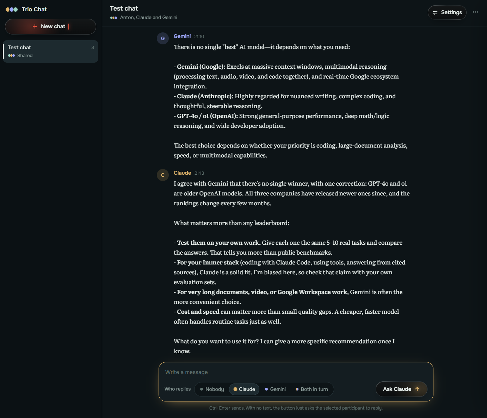
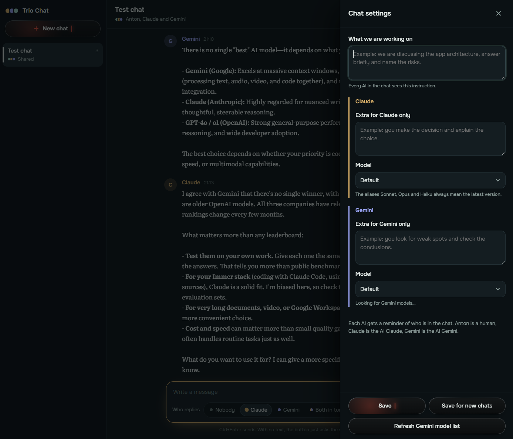

# Trio Chat

A local web chat where **you, Claude and Gemini talk in one conversation**. You decide who answers next; each AI sees the full history, including what the other one said.

It needs no API keys and no extra dependencies. It drives the command-line tools you already have installed and logged in to:

- **Claude** via `claude -p` (Claude Code CLI)
- **Gemini** via `agy -p` (Antigravity CLI)

Your existing subscriptions do the work. Pure Python standard library, a single file, listens on `localhost` only.





## What it is for

- **Second opinion.** Ask Claude, then ask Gemini to critique or extend the answer, in the same thread.
- **Debate and brainstorming.** Give each AI a different role ("you favour local options", "you favour budget options") and let them argue while you steer.
- **Comparing models.** Same question, same context, two models side by side. Pick exact model versions per chat.
- **Forking.** Copy a shared chat into a private one with a single model to continue the thread one-on-one.

## Features

- Shared chats (you + Claude + Gemini) and solo chats (you + one AI).
- Per-chat settings: a shared instruction both AIs see, plus a separate instruction for Claude and for Gemini.
- Model picker for each AI. The Gemini list is read live from `agy models`; the Claude list is a built-in catalogue plus a custom field.
- Save the current settings as defaults for new chats.
- Chats stored in a local `chats.json`.
- Long histories are trimmed to the newest messages that fit each model's limit.
- Dark UI, works in any modern browser.

## Requirements

- Python 3.9 or newer
- [Claude Code](https://docs.claude.com/en/docs/claude-code) CLI (`claude`) installed and signed in
- Antigravity CLI (`agy`) installed and signed in

You can run with only one of them installed. The other AI will just return an error message in the chat.

## Quick start

```bash
git clone https://github.com/<your-username>/trio-chat.git
cd trio-chat
python trio_chat.py
```

The browser opens at <http://127.0.0.1:8765>.

1. Click **New chat**, choose *shared* or *solo*.
2. Type a message.
3. Press the **Claude** or **Gemini** button to ask that AI to reply. Ask them one after another to get a discussion.
4. Open **Settings** to set instructions and models.

## Configuration

Environment variables:

| Variable | Default | Meaning |
|---|---|---|
| `TRIO_PORT` | `8765` | Port of the local server |
| `TRIO_CLAUDE_BIN` | `claude` | Path or name of the Claude CLI |
| `TRIO_AGY_BIN` | `agy` | Path or name of the Antigravity CLI |

Constants at the top of [trio_chat.py](trio_chat.py): `USER` (your display name), `TIMEOUT` (seconds per reply), `MAX_INSTR` (max instruction length), per-model history `limit`, and the `CLAUDE_MODELS` list.

## How it works

For every reply the server builds one prompt: who is in the chat, your instructions, the recent history, and "write your next message". It runs the CLI in an empty `sandbox_cwd` folder with no tools, so the AI only returns text and does not touch your files. Gemini runs in `plan` mode for the same reason.

## Security and privacy

- Binds to `127.0.0.1` only and rejects requests with a foreign `Host` or `Origin`.
- Model names are validated before reaching the command line.
- **Your messages are sent to Anthropic and Google** through their CLIs, under your accounts and their terms.
- `chats.json` holds your conversations in plain text. Do not commit it (see `.gitignore`).
- Do not expose the port to a network. There is no authentication.

## Known limitations

- Replies arrive when the CLI finishes; there is no token streaming.
- Each reply starts a fresh CLI process, so it takes a few seconds or more.
- Developed and tested on Windows. Linux and macOS should work but are untested.
- The UI is English only; the AIs are told to answer in English unless asked otherwise. The display name is the `USER` constant.
- The `agy models` output format is parsed heuristically and may need adjustment if the tool changes.

## License

MIT. See [LICENSE](LICENSE).
